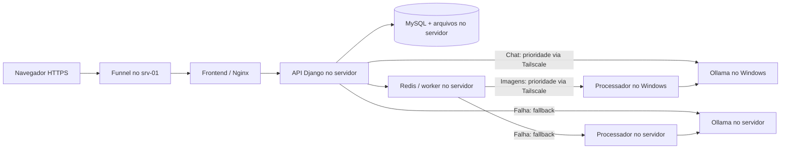

# Servidor completo com prioridade de processamento no Windows

O site continua em **https://srv-01.tail881f91.ts.net/**. O servidor executa
frontend, API Django, MySQL, arquivos, Redis, worker e serviços locais de IA/imagens.
Para cada solicitação de IA ou processamento automático, tenta primeiro o Windows
pelo Tailscale e usa os serviços locais se a tentativa falhar.

**API, usuários, tokens, rótulos, progresso e arquivos ficam sempre no servidor.**
A troca não alterna bancos nem exige sincronizar dois conjuntos de dados.
A edição manual continua disponível sem IA ou processamento automático.

O chat também pode usar **OpenRouter**, selecionado em `IA_module/study_assistant.py`.
Nesse modo, o chat e os embeddings saem diretamente da API no servidor para o
OpenRouter; preencha `OPENROUTER_MODEL` e `OPENROUTER_API_KEY` no `.env` **do servidor**.
A prioridade Windows/fallback descrita abaixo permanece para Ollama e imagens.
Veja [configuração e atualização somente da API](IA_module/README.md#atualizar-somente-o-container-que-executa-o-módulo).



| Dispositivo | Compose | Papel |
| --- | --- | --- |
| Servidor Linux | `compose.server.yaml` | Aplicação completa e dados; processamento local de reserva |
| PC com Ubuntu WSL ou Docker Desktop em modo Linux | `compose.windows.yaml` | Ollama e processamento preferenciais; gateway privado |
| Uma máquina sem failover | `compose.yaml` | Pilha local original |

`compose.compute.yaml` reúne as definições compartilhadas de Ollama, modelos e
processador. Envie os arquivos Compose juntos com o código. Execute os comandos
na raiz do projeto e mantenha o nome de projeto usado anteriormente (`-p NOME`,
caso já utilizasse), para reutilizar os volumes existentes.

## 1. PC: serviços preferenciais

### Ubuntu WSL com Tailscale instalado no Ubuntu

Execute no terminal **Ubuntu**, na pasta do projeto. O nome `compose.windows.yaml`
identifica o papel do PC e também funciona com Docker Engine dentro do WSL;
nessa configuração não é necessário iniciar Docker Desktop.

Se `tailscale ip -4` responder `NeedsLogin`, autentique o Ubuntu na mesma tailnet
do servidor. O comando abaixo mostra um link para concluir o login no navegador:

```bash
sudo tailscale up
tailscale ip -4
```

Depois de concluir o login, inicie os serviços e o encaminhamento **no Ubuntu**:

```bash
test -f .env || cp .env.example .env
docker compose -f compose.windows.yaml up -d --build
sudo tailscale serve --bg --tcp=8081 tcp://127.0.0.1:8081
tailscale serve status
curl --fail http://127.0.0.1:8081/image-processor/health
```

Use o IP retornado por `tailscale ip -4` **dentro do Ubuntu** em `BACKEND_UPSTREAM`
no servidor. O endereço deve ser `http://100.x.y.z:8081`; o IP interno do WSL
mostrado por `hostname -I` não substitui esse endereço.
Mantenha a distribuição WSL e o Docker ativos para atender as solicitações.

O Tailscale no WSL é um dispositivo separado na tailnet. Se usar Tailscale no
Windows, siga a alternativa abaixo; evite executar as duas instâncias ao mesmo
tempo devido às limitações de rede descritas na
[documentação de WSL do Tailscale](https://tailscale.com/docs/install/windows/wsl2).

### Alternativa: Tailscale no Windows e Docker Desktop

Inicie Docker Desktop e conecte o Tailscale à mesma tailnet do servidor.
Use PowerShell como administrador para configurar o Serve:

```powershell
if (!(Test-Path .env)) { Copy-Item .env.example .env }
tailscale status
tailscale ip -4
docker compose -f compose.windows.yaml config --quiet
docker compose -f compose.windows.yaml up -d --build
tailscale serve --bg --tcp=8081 tcp://127.0.0.1:8081
tailscale serve status
Invoke-RestMethod http://127.0.0.1:8081/image-processor/health
Invoke-RestMethod http://127.0.0.1:8081/ollama/api/tags
```

Anote o IP **Tailscale do Windows**, no formato `100.x.y.z`. Se o comando não
estiver no PATH, use `& 'C:\Program Files\Tailscale\tailscale.exe'`.
O gateway publica somente em localhost no Windows. O
[Serve TCP](https://tailscale.com/docs/reference/tailscale-cli/serve) expõe a porta
8081 dentro da tailnet. Não é necessário abrir portas do roteador nem usar Funnel
no PC. Se alterar `BACKEND_PORT` no `.env`, ajuste o destino local do comando Serve.

O Windows não executa mais Django, MySQL, Redis ou worker nesse Compose e não
precisa das credenciais do servidor. Pode manter o `.env` Windows existente;
um arquivo novo precisa apenas das opções de modelos, OCR e `BACKEND_PORT`.

Se já executou a arquitetura anterior com banco/arquivos no PC, consulte a seção
**Dados da arquitetura anterior** antes de parar os containers antigos. Depois
de transferir/conferir os dados no servidor, pare os serviços antigos do Windows
usando o Compose original (os volumes são preservados):

```powershell
docker compose -f compose.yaml stop frontend worker api redis db
```

## 2. Servidor: frontend e backend completos

Atualize o código do servidor. Se utiliza Git, publique as alterações na branch
de implantação e execute `git pull --ff-only` no servidor.
Preserve o `.env` **do servidor**, com as credenciais do banco já existente.
Crie os arquivos somente se ainda não existirem:

```bash
test -f .env || cp .env.example .env
test -f .env.server || cp .env.server.example .env.server
```

Para instalação nova, configure `DJANGO_SECRET_KEY`, `DJANGO_SUPERUSER_PASSWORD`,
`MYSQL_PASSWORD` e `MYSQL_ROOT_PASSWORD` em `.env`. Mudar a senha nesse arquivo não
altera uma conta MySQL já criada. Mantenha as credenciais anteriores ao atualizar.
Em `.env.server`, use o IP real do Windows:

```dotenv
APP_PORT=80
BACKEND_UPSTREAM=http://100.x.y.z:8081
PUBLIC_SCHEME=https
OLLAMA_PRIMARY_TIMEOUT=60
OLLAMA_REQUEST_TIMEOUT=300
IMAGE_PROCESSOR_PRIMARY_TIMEOUT=120
IMAGE_PROCESSOR_TIMEOUT=1800
DJANGO_ALLOWED_HOSTS=srv-01.tail881f91.ts.net,localhost,127.0.0.1
CSRF_TRUSTED_ORIGINS=https://srv-01.tail881f91.ts.net
SESSION_COOKIE_SECURE=true
CSRF_COOKIE_SECURE=true
SECURE_SSL_REDIRECT=false
```

`BACKEND_UPSTREAM` agora serve **somente para IA/imagens**, mantendo compatibilidade
com o nome da variável anterior. Não coloque `/api/` nem barra final. O frontend
encaminha API, admin e downloads exclusivamente ao backend local do servidor.
`APP_PORT` deve corresponder à porta local já usada pelo Funnel.

Carregue os **dois** arquivos de ambiente, nessa ordem, e inicie **todos** os serviços:

```bash
docker compose --env-file .env --env-file .env.server -f compose.server.yaml config --quiet
docker compose --env-file .env --env-file .env.server -f compose.server.yaml up -d --build
docker compose --env-file .env --env-file .env.server -f compose.server.yaml ps
docker compose --env-file .env --env-file .env.server -f compose.server.yaml exec frontend nginx -t
curl --fail https://srv-01.tail881f91.ts.net/api/health/
```

Não acrescente apenas `frontend` ao comando `up`: o backend local precisa estar
ativo para persistência e fallback. Não pare mais os serviços backend do servidor.
A inicialização da API aplica migrações e reúne os arquivos estáticos do admin.
Mantenha o Funnel existente se já aponta para a porta correta. Caso precise
configurá-lo para a porta 80:

```bash
sudo tailscale funnel --bg http://127.0.0.1:80
tailscale funnel status
```

O [Funnel](https://tailscale.com/docs/reference/tailscale-cli/funnel) mantém o site
público com HTTPS. Visitantes não precisam instalar Tailscale. O tráfego entre
servidor e Windows usa a tailnet; permita somente ao servidor alcançar TCP 8081
no PC nas regras de acesso da tailnet.

## 3. Como a troca funciona

- **Windows disponível:** chat, embeddings e imagens tentam o Windows primeiro.
- **Falha de conexão, timeout ou erro do serviço:** a aplicação tenta o serviço
  local na mesma solicitação/tarefa. O chat também usa o local se faltar o modelo
  no Windows. A disponibilidade do chat considera os dois Ollamas.
- **Windows voltou:** a próxima solicitação tenta o Windows novamente. Uma tarefa
  já iniciada localmente termina onde começou.
- **Rejeição da imagem (HTTP 4xx, como 413/415/422):** o erro é apresentado sem
  reenviar para outro processador. Rota ausente (404), HTTP 408/429 e erros 5xx permitem fallback.
- **Os dois falharam:** o chat informa indisponibilidade; o processamento mantém
  as tentativas Celery existentes para falhas de transporte/serviço.

A conexão espera até 3 segundos por tentativa. Se a conexão for estabelecida e
ficar sem resposta, `OLLAMA_PRIMARY_TIMEOUT` limita a espera inicial no Windows;
`OLLAMA_REQUEST_TIMEOUT` é o orçamento de leitura das tentativas do chat, dividido
entre as duas máquinas. Para imagens, o limite inicial é
`IMAGE_PROCESSOR_PRIMARY_TIMEOUT` e o local usa `IMAGE_PROCESSOR_TIMEOUT`.
O processamento é assíncrono. Modelos frios ou downloads podem ultrapassar esses
limites; ajuste-os conforme o hardware, mantendo os limites do worker/proxy.

O reenvio envolve somente operações de cálculo sem persistência no Windows. O
worker do servidor lê novamente o arquivo completo e salva um único resultado no
banco/armazenamento. Uma tentativa remota que excedeu o timeout pode continuar
consumindo CPU até terminar, mas seu resultado tardio não é salvo.

O processador local usa seu próprio Ollama na etapa visual opcional. A melhoria
visual mantém o comportamento anterior: se essa etapa falhar, a imagem reconstruída
é preservada com um aviso nos metadados. O modo manual não consulta esses serviços.

**Prepare modelos nas duas máquinas.** Use os mesmos nomes nas variáveis
`OLLAMA_CHAT_MODEL` (ou `OLLAMA_LLM_MODEL`), `OLLAMA_EMBEDDING_MODEL` e
`OLLAMA_VISION_MODEL`. Para aprimoramento visual, configure `IMAGE_USE_OLLAMA=true`
em ambas e execute novamente `ollama-models`. Confira os downloads:

```bash
# Servidor
docker compose --env-file .env --env-file .env.server -f compose.server.yaml logs -f ollama-models
```

```powershell
# Windows
docker compose -f compose.windows.yaml logs -f ollama-models
```

OCR/CLIP são baixados no primeiro processamento em cada máquina. Processe uma
imagem com o Windows ativo e outra com ele parado antes de depender do fallback.
O servidor precisa de memória/CPU para executar os modelos locais.

## 4. Dados da arquitetura anterior

Se os dados continuam no servidor e o projeto Compose tem o mesmo nome, seus
volumes serão reutilizados. **Não mova o banco do servidor para o Windows.**

Se os dados mais recentes foram criados no Windows na arquitetura anterior,
transfira uma cópia consistente para o servidor antes da troca. Os volumes não
se sincronizam automaticamente. Se ambos os bancos receberam novas edições, será
necessário reconciliá-los antes de escolher uma cópia; restaurar um dump não
combina dois bancos.

Para exportar do Windows, interrompa novos uploads (pare temporariamente o frontend
no servidor), aguarde as tarefas em andamento e use os containers antigos ainda
existentes. No PowerShell 7, com `.env` Windows e nome de projeto originais:

```powershell
New-Item -ItemType Directory -Force backup
docker compose -f compose.yaml stop worker
docker compose -f compose.yaml exec -T db sh -c 'MYSQL_PWD="$MYSQL_PASSWORD" mysqldump --single-transaction --no-tablespaces -u"$MYSQL_USER" "$MYSQL_DATABASE" > /tmp/anato360.sql'
docker compose -f compose.yaml cp db:/tmp/anato360.sql ./backup/anato360.sql
docker compose -f compose.yaml exec -T api tar -czf /tmp/anato360-media.tar.gz -C /app/media .
docker compose -f compose.yaml cp api:/tmp/anato360-media.tar.gz ./backup/anato360-media.tar.gz
```

Transfira os dois arquivos para `backup/` no projeto do servidor por um canal
privado. Guarde também um backup do banco/arquivos atuais do servidor antes de
importar. Dumps contêm dados de usuários e não devem ser versionados.

A restauração abaixo **substitui as tabelas de mesmo nome**. Use-a somente depois
de escolher o conjunto correto de dados e parar API/worker do destino:

```bash
docker compose --env-file .env --env-file .env.server -f compose.server.yaml stop frontend api worker
docker compose --env-file .env --env-file .env.server -f compose.server.yaml build api
docker compose --env-file .env --env-file .env.server -f compose.server.yaml up -d --wait db
docker compose --env-file .env --env-file .env.server -f compose.server.yaml cp ./backup/anato360.sql db:/tmp/anato360.sql
docker compose --env-file .env --env-file .env.server -f compose.server.yaml exec -T db sh -c 'MYSQL_PWD="$MYSQL_PASSWORD" mysql -u"$MYSQL_USER" "$MYSQL_DATABASE" < /tmp/anato360.sql'
docker compose --env-file .env --env-file .env.server -f compose.server.yaml run --rm --no-deps --entrypoint sh -v "$PWD/backup:/backup:ro" api -c 'mkdir -p /app/media; tar -xzf /backup/anato360-media.tar.gz -C /app/media'
docker compose --env-file .env --env-file .env.server -f compose.server.yaml up -d --build
```

Use o mesmo nome de banco/usuário e confira as credenciais do destino. A fila Redis
não é transferida: finalize os trabalhos antes da exportação. Depois de verificar
login, biblioteca e quiz no servidor, pare os serviços antigos do Windows conforme
a seção 1. Não use `down -v` ou exclusão de volumes para fazer essa atualização.

## 5. Conferir prioridade, fallback e atualizações

No servidor, teste a rota privada antes de testar a aplicação:

```bash
tailscale ping 100.x.y.z
curl --fail --connect-timeout 5 http://100.x.y.z:8081/image-processor/health
curl --fail --connect-timeout 5 http://100.x.y.z:8081/ollama/api/tags
docker compose --env-file .env --env-file .env.server -f compose.server.yaml logs -f api worker
```

Faça uma pergunta no chat e processe uma imagem. Com o Windows ativo, devem usar
o PC. Pare temporariamente os serviços de cálculo do Windows para testar o local:

```powershell
docker compose -f compose.windows.yaml stop image-processor ollama
# Depois de testar o fallback no site:
docker compose -f compose.windows.yaml up -d image-processor ollama
```

Os logs da API/worker registram `tentando o fallback`. A resposta da imagem contém
`processing_metadata.processor_backend`: `primary` (Windows nesse Compose) ou
`fallback` (servidor). Confirme que chat, biblioteca e edição manual continuam
funcionando com o PC desligado. Ao reiniciar os serviços do PC, uma nova imagem
volta a registrar `primary`.

Atualizações seguintes, após sincronizar o código:

```powershell
# Windows
docker compose -f compose.windows.yaml up -d --build
```

```bash
# Servidor
docker compose --env-file .env --env-file .env.server -f compose.server.yaml up -d --build
curl --fail https://srv-01.tail881f91.ts.net/api/health/
```

- `/healthz` verifica só o gateway; `/image-processor/health` verifica o processador;
  `/ollama/api/tags` lista os modelos no PC; `/api/health/` público verifica API/banco
  do servidor. Esse último permanece saudável quando o Windows está desligado.
- Acesso funciona no host, mas não no container: confira firewall/roteamento Docker
  para Tailscale. Não abra as portas dos modelos na internet para corrigir a rota.
- `400 DisallowedHost` ou `403 CSRF` no admin: confira host/origem HTTPS em `.env.server`.
- Falha local: confira logs, memória disponível e modelos baixados no servidor.
- O gateway privado do Windows deixou de servir `/api/`; seus endpoints são os de
  cálculo acima. MySQL e Redis permanecem sem portas públicas.

Testes automatizados: `python manage.py test api --settings=backend.test_settings`,
`python -m unittest discover -s IA_module/tests -v` e
`python -m unittest discover -s imageService/tests -v`. Verificam prioridade,
queda/retorno, reenvio completo de arquivos, rejeição de entradas e persistência única.
